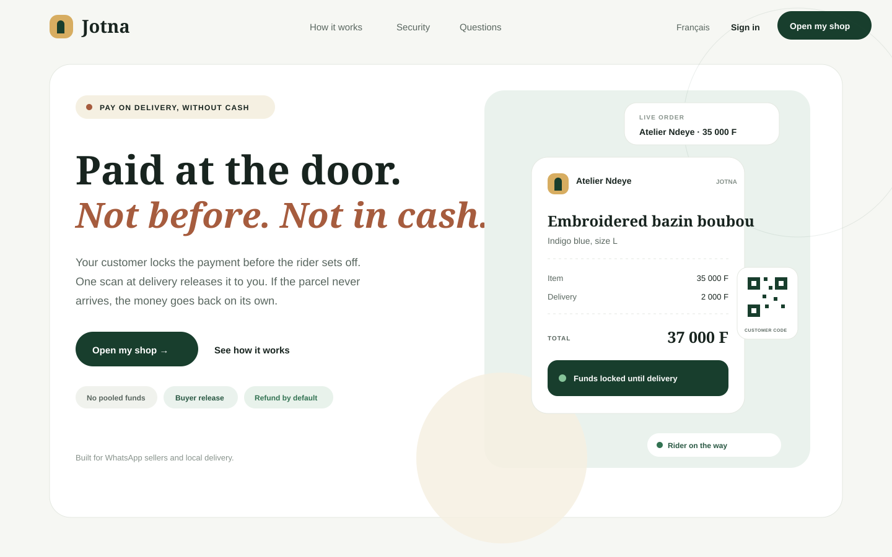
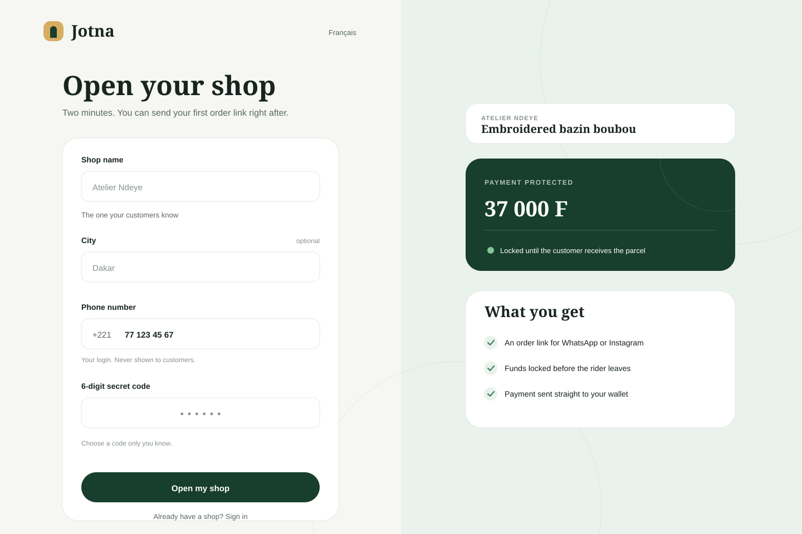
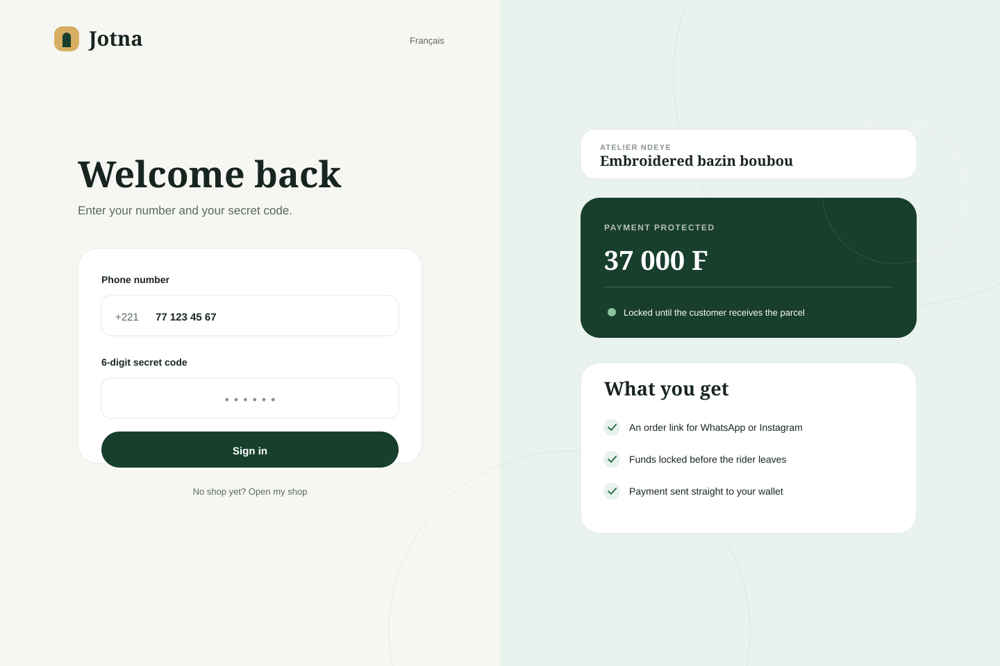
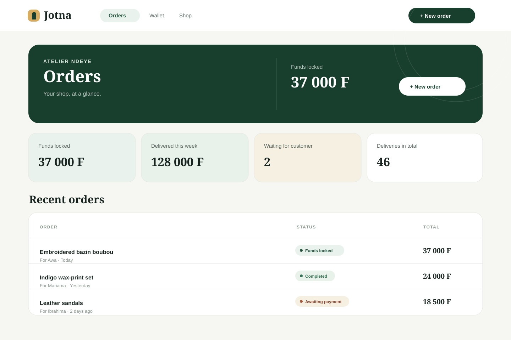
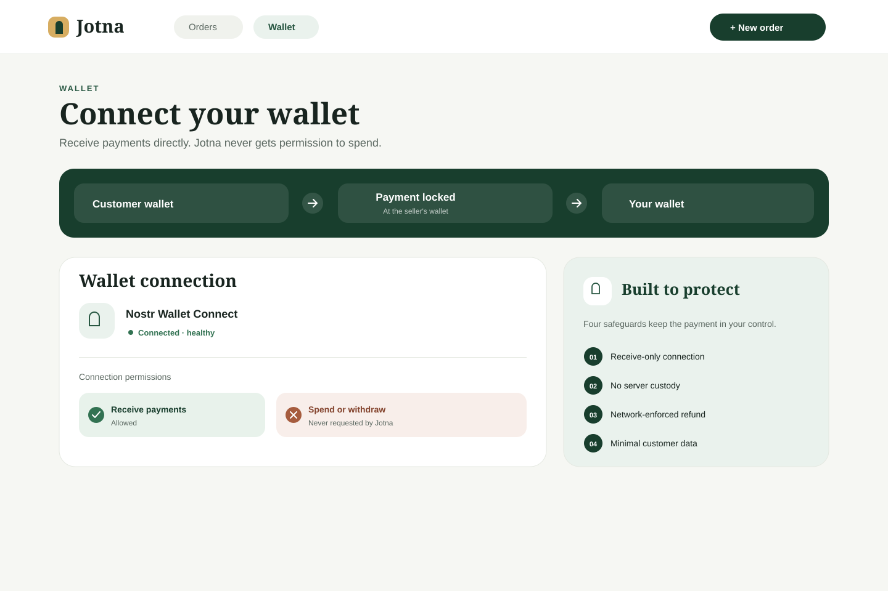
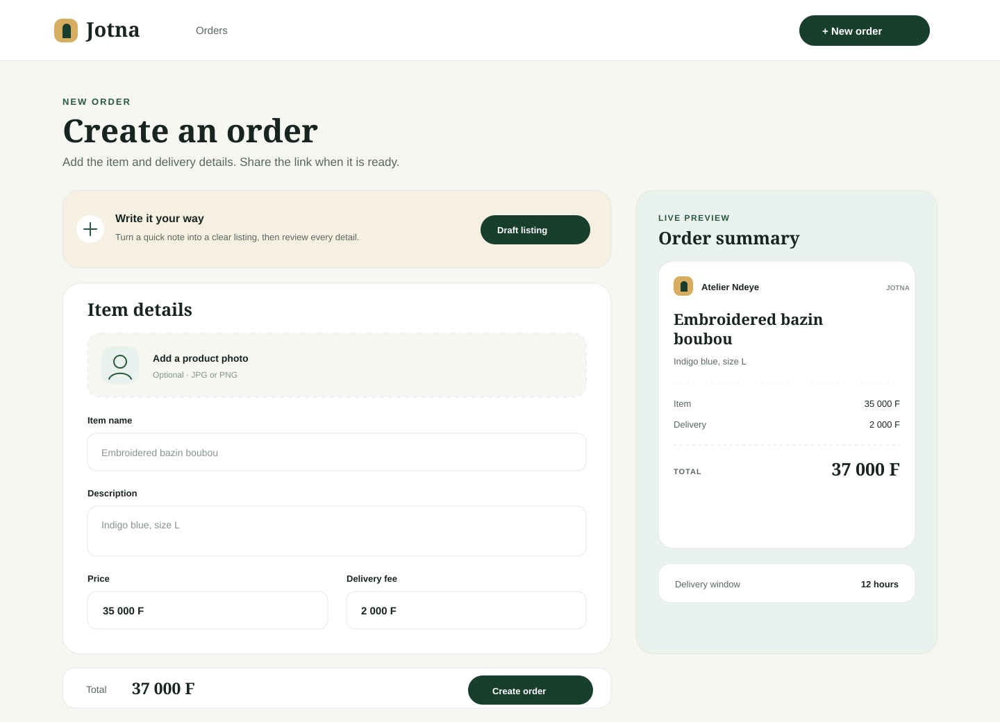
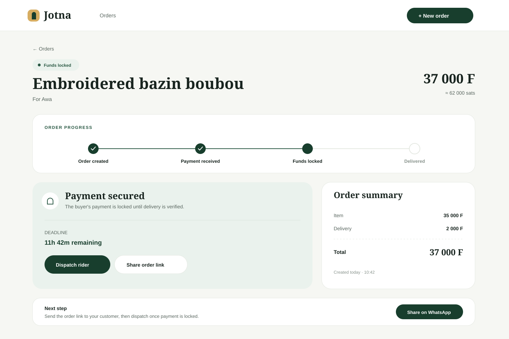

# Jotna

<p align="center">
  
</p>

[](https://github.com/jotna/jotna/actions/workflows/ci.yml)
[](LICENSE)
[](https://nodejs.org)
[](https://nextjs.org)
[](https://lightning.engineering)

Jotna is a buyer-seller escrow flow for informal commerce. It turns cash-on-delivery into a trust-preserving Lightning payment flow where the buyer locks funds before the rider leaves and only releases them after verifying the parcel at the door.

## Table of contents

- [Overview](#overview)
- [Why it matters](#why-it-matters)
- [Product flow](#product-flow)
- [Core architecture](#core-architecture)
- [Stack](#stack)
- [Page gallery](#page-gallery)
  - [Hero](#hero)
  - [Create shop](#create-shop)
  - [Login](#login)
  - [Dashboard](#dashboard)
  - [Wallet connection](#wallet-connection)
  - [Create order](#create-order)
  - [Order view](#order-view)
- [Repository structure](#repository-structure)
- [Local development](#local-development)
- [Validation](#validation)
- [Production deployment](#production-deployment)
- [Security and compliance](#security-and-compliance)
- [Contributing](#contributing)
- [License](#license)
- [Roadmap](#roadmap)

## Overview

Jotna is built for markets where WhatsApp and Instagram are the main sales channels, buyers do not trust cash-on-delivery, and sellers do not want to hold pooled funds or manage a fragile middleman. The product reduces fraud, lowers delivery disputes, and keeps the flow simple enough for a seller to understand in under a minute.

## Why it matters

- Sellers operate in chat-driven, low-trust marketplaces.
- Cash on delivery creates fake-order and refusal risk for both sides.
- Trust breaks down when a rider carries cash and a seller waits on a customer who never collects.
- Lightning hold invoices allow a secure release flow without server custody.

## Product flow

1. Seller creates an order link.
2. Buyer pays via a Lightning wallet.
3. The funds are locked on the seller wallet, not held by Jotna.
4. Rider delivers the item.
5. Buyer verifies the parcel and releases payment.
6. If the buyer does not release before the deadline, the funds return automatically.

## Core architecture

- Web app: Next.js storefront and merchant dashboard
- API: Fastify backend with auth, order lifecycle, wallet setup, and AI listing support
- Database: Postgres for durable state, order history, wallet configuration, and events
- Wallet layer: LND and Nostr Wallet Connect integrations
- Worker: background reconciler for timeouts, settlements, and refunds
- Nostr: signed receipts and public trust signals

## Stack

- Next.js 16
- React 19
- TypeScript 7
- Fastify 5
- Postgres
- LND / Nostr Wallet Connect
- Zod validation
- Vitest and production build verification

## Page gallery

The gallery contains interface previews of the redesigned public and seller pages. Seller screens represent the authenticated interface.

### Hero



A focused preview of the storefront hero and customer order example.

### Create shop



A focused merchant onboarding form with a live order example and product benefits.

### Login



A compact sign-in experience paired with a protected-payment product preview.

### Dashboard



A seller overview with locked funds, delivery metrics, and recent orders.

### Wallet connection



A wallet setup view that explains the payment path and receive-only connection safeguards.

### Create order



A two-column order form with an updating customer-facing ticket preview.

### Order view



An order detail view with payment progress, the next action, and a clear price breakdown.

## Repository structure

```text
jotna/
├── .github/
│   ├── ISSUE_TEMPLATE/
│   │   ├── bug_report.yml
│   │   ├── config.yml
│   │   └── feature_request.yml
│   ├── workflows/
│   │   └── ci.yml
│   ├── dependabot.yml
│   └── PULL_REQUEST_TEMPLATE.md
├── apps/
│   ├── api/
│   │   ├── src/
│   │   ├── scripts/
│   │   ├── package.json
│   │   └── tsconfig.json
│   └── web/
│       ├── src/
│       ├── public/
│       ├── package.json
│       └── tsconfig.json
├── docs/
│   ├── deployment.md
│   └── images/
│       ├── hero.svg
│       ├── start.svg
│       ├── login.svg
│       ├── dashboard.svg
│       ├── wallet.svg
│       ├── create-order.svg
│       └── order.svg
├── CODE_OF_CONDUCT.md
├── CONTRIBUTING.md
├── LICENSE
├── PRIVACY.md
├── README.md
├── SECURITY.md
├── package.json
├── package-lock.json
└── .gitignore
```

## Local development

```bash
npm install
npm run dev:stack
npm run dev:api
npm run dev:web
```

The local stack bootstraps a Bitcoin regtest and LND setup so the escrow flow can be tested in a realistic environment.

## Validation

```bash
npm test
npm run test:api
npm run test:web
npm run typecheck
npm run build
```

For the full local Lightning lifecycle test, start `npm run dev:stack` and `npm run dev:api` in separate terminals, then run:

```bash
npm run test:e2e
```

## Production deployment

See [docs/deployment.md](docs/deployment.md) for production configuration, HTTPS, health checks, and worker scaling guidance.

## Security and compliance

- Trust model is wallet-first and custody-free
- Input validation is enforced through schema checks
- Secret handling is designed to avoid leaking wallet or payment data
- Security reporting is handled through the repository security policy

See [SECURITY.md](SECURITY.md), [PRIVACY.md](PRIVACY.md), and [CODE_OF_CONDUCT.md](CODE_OF_CONDUCT.md) for operational details.

## Contributing

We welcome contributions from engineers, designers, and product operators. See [CONTRIBUTING.md](CONTRIBUTING.md) for the contribution flow and standards.

## License

This project is released under the [MIT License](LICENSE).

## Roadmap

- Seller wallet onboarding and health checks
- Buyer order release flow and QR verification
- Stronger seller reputation and trust signals
- Better multilingual UX for French, English, and Wolof
- Final delivery rider accountability and dispute flow
